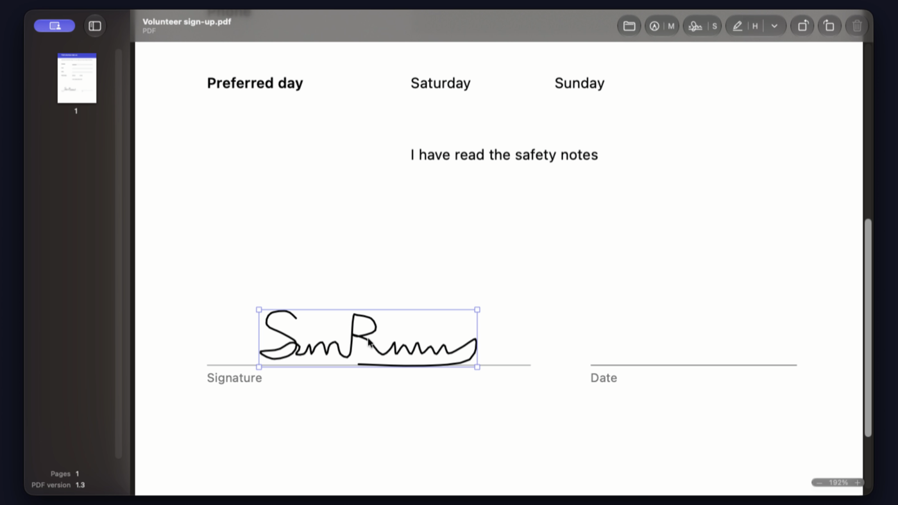
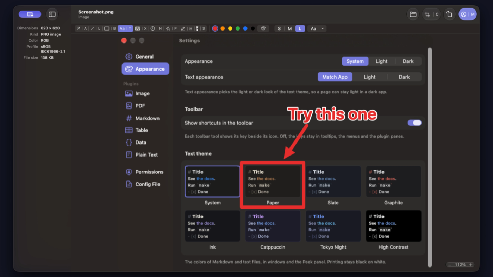
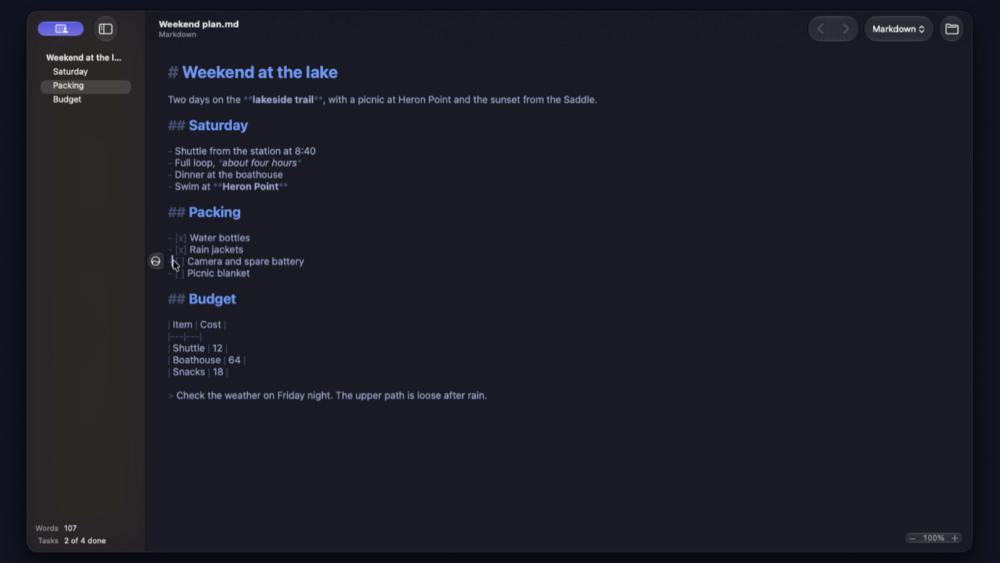
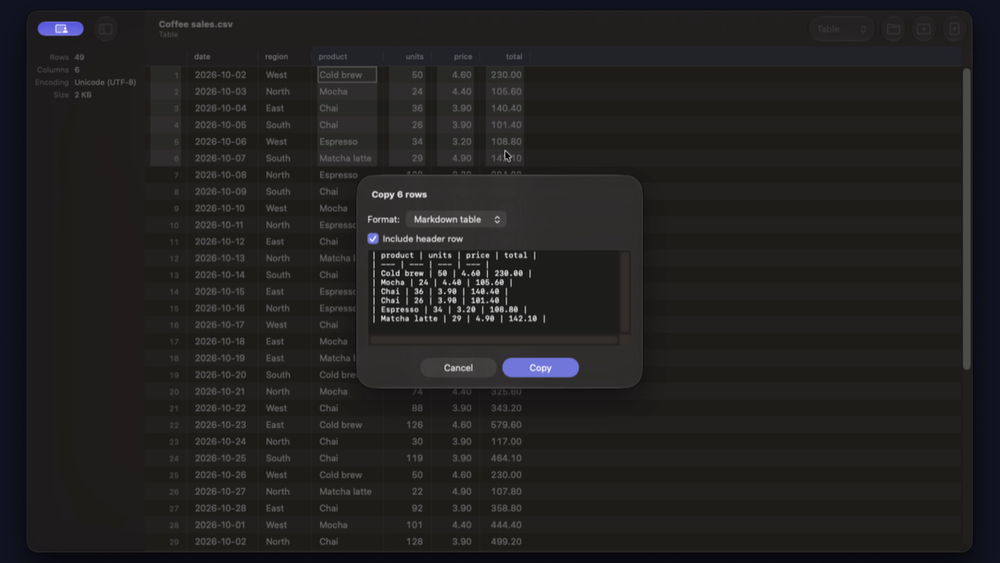

<p align="center">
  
</p>

<h1 align="center">Peeker</h1>

<p align="center">
  <em>See it. Fix it.</em>
</p>

<p align="center">
  <a href="https://github.com/oribarilan/peeker/actions/workflows/tests.yml"></a>
  &nbsp;
  
  &nbsp;
  <a href="LICENSE"></a>
</p>

<p align="center">
  
</p>

<p align="center">
  Press Space on a file in Finder to see it. Open it to fix it.<br>
  Free and open source, as fast as Preview and sometimes much faster.
</p>

<table>
  <tr>
    <td width="50%"><br>Fill in and sign PDFs</td>
    <td width="50%"><br>Mark up screenshots</td>
  </tr>
  <tr>
    <td><br>Write Markdown</td>
    <td><br>Edit CSV tables</td>
  </tr>
</table>

## Install

Coming with the first release:

```sh
brew install --cask oribarilan/tap/peeker
```

or the DMG from [Releases](https://github.com/oribarilan/peeker/releases). Until then, build it with Xcode 26+ and [XcodeGen](https://github.com/yonaskolb/XcodeGen):

```sh
scripts/build.sh
open build/dd/Build/Products/Release/Peeker.app
```

## More

- [Config file](docs/config.md), for settings you'd rather edit by hand or hand to an agent, with `schema.json` beside it describing every key
- [CONTRIBUTING.md](CONTRIBUTING.md), to add a format or fix something
- [BENCHMARKS.md](BENCHMARKS.md), for how fast it opens files

<details>
<summary>Benchmark highlights</summary>

<!-- bench:start -->
| Opening, app not running | Apple | Peeker | |
|---|---|---|---|
| PDF, 2,000 pages | Preview 661 ms | 305 ms | **2.2× faster** |
| JPEG, 12 MP | Preview 394 ms | 368 ms | about the same |
| PNG, 48 MP | Preview 1102 ms | 675 ms | **1.6× faster** |
| Markdown, 1 KB | TextEdit 286 ms | 285 ms | about the same |

The Peek panel shows a PDF in 14 ms and a 12 MP photo in 125 ms.

Apple M6, macOS 27.0.1, 2026-10-29. Apple's apps are timed until their window appears, Peeker until its content is drawn. Every file, method and caveat: [BENCHMARKS.md](BENCHMARKS.md).
<!-- bench:end -->

</details>
